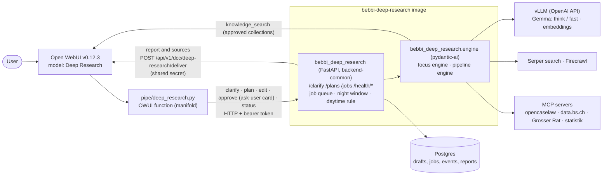

# bebbi-deep-research

Deep-research agent for **Bebbi Bot** (Open WebUI of the canton of Basel-Stadt). The user picks the model "Deep
Research" in the chat, confirms where to research (the service suggests a preset such as Recht or Grosser Rat), answers
at most two clarifying questions, approves or edits a research plan, and
gets a cited German report back in the same chat. Heavy runs happen at night; quick runs of the focus engine may start
during office hours.

This repository is the self-contained production deliverable. The evaluation that led to it (benchmarks, alternatives,
tuning history) lives in the evaluation repository, see [docs/evaluation.md](docs/evaluation.md).

## Architecture



* **pipe** (`pipe/deep_research.py`): Open WebUI manifold function with one model, "Deep Research"; the user confirms
  the suggested preset per task in an ask-user card (valve `PRESET_MODELS` lists one model per preset as before). Depends only on `httpx` and
  `pydantic`. The user approves, changes or discards the plan in Open WebUI's ask-user card; approved researches run in
  the night window. Keeps the job state in a hidden marker of the assistant message, emits the sources as native
  citations (`[n]` badges, source list) and attaches the Word file. `pipe/deep_research_download.py` is the action that
  adds the Word file to a report delivered later.
* **service** (`src/bebbi_deep_research/`): FastAPI job service on `dcc-backend-common` (config, structlog logging,
  health probes, error format, request logging) with a Dependency Injector container. Chat-turn endpoints, a job queue
  in Postgres (SQLite for development), the night window, report delivery into the chat, structured sources and the
  Word export (`GET /jobs/{id}/report.docx`). Stateless apart from the database, so restarts re-queue running jobs.
* **engine** (`src/bebbi_deep_research/engine/`): focus engine (tool-calling loop with code-resolved citations) for
  administrative presets, pipeline engine (plan, research rounds, section-wise writing) for broad web surveys. Prompts,
  presets and the citation layer are the evaluated version (v7); the LLM layer runs on backend-common's pydantic-ai
  agents since 2026-10-13 and needs a re-run of the evaluation sets (docs/evaluation.md).
* **config** (`config/presets.yaml`): presets, MCP servers, budgets. Mounted as ConfigMap in Kubernetes.

## Own sources (files and knowledge bases)

Files uploaded in the chat and knowledge bases attached to the chat or to the model are research sources next to the web (requirement A4).
The pipe checks inside Open WebUI, as the chat user, what the user may read (Open WebUI's own access functions) and sends the extracted file
texts and the knowledge base ids with the plan and the job; the service stores them with the job (night runs do not need the user's session),
the engine reads uploads with `read_upload` (small ones directly) and searches the knowledge bases with `knowledge_search` through Open WebUI's
retrieval endpoint, one approved id at a time. Citations show the file name ("Hochgeladene Datei") or document and knowledge base
("Wissensbasis ..."), with a link the user can open when Open WebUI allows it. Preset field `own_sources: prefer | only | off`; the model
"Deep Research · Eigene Dokumente" works on the user's documents alone. Limits: 10 files, 2,000,000 characters per file, 5 knowledge bases per
research (`RA_OWN_MAX_*`); text only: Open WebUI extracts it (Docling with OCR in the Bebbi Bot deployment, so scans arrive as text). Details, access rules and what was verified:
[docs/integration.md](docs/integration.md#5b-own-sources-uploaded-files-and-knowledge-bases-requirement-a4) and section 7 there.

## Quickstart (local)

Tooling: [mise](https://dcc-bs.github.io/documentation/dev-setup/mise.html) (uv, varlock, pass-cli pinned in
`mise.toml`), configuration via [varlock](https://dcc-bs.github.io/documentation/dev-setup/varlock.html) (`.env.schema`,
secrets from Proton Pass in `.env.dev.schema`).

```bash
mise trust && mise install               # toolchain; the postinstall hook runs `uv sync` and installs pre-commit
mise run check                           # lockfile, ruff format + lint, ty, varlock scan
mise run test:unit                       # unit tests (CI runs `mise run ci`)
mise run dev                             # service with auto-reload on :8088 (secrets via varlock / Proton Pass)

mise run docker:up                       # service + Postgres + Open WebUI v0.12.3 (docker-compose.dev.yml)
curl localhost:8088/health/liveness      # {"status":"up",...}; /health/readiness checks the database, /health/dependencies the LLM and Open WebUI
uv run python scripts/install_pipe.py --service-url http://service:8088 --models   # pipe + valves (docs/integration.md)
```

Open <http://localhost:3000>, pick "Deep Research", ask a question and choose "Grosser Rat" in the card. Without Open WebUI:

```bash
RA_TOKEN=... uv run python scripts/test_pipe.py "Welche Vorstösse zum Stadtklima gab es? Bitte schnell." grossrat   # service window must cover now
EVAL_ENV=/path/to/deep-research-evaluation/.env scripts/smoke_local.sh   # needs the evaluation stack (LLM gateway, Firecrawl); service on SQLite
```

## Layout

| Path | Content |
|---|---|
| `src/bebbi_deep_research/` | `app.py` (FastAPI factory), `container.py` (dependency injection), `routers/`, `models/` (requests), `services/` (research service, job runner, job policy, DB, own sources, report, Word export), `utils/` (config, API errors) |
| `src/bebbi_deep_research/engine/` | research engine: `agent.py` (`ResearchAgent`, the entry point for services), `engines.py` (`Engine` protocol and registry), `context.py` (`EngineContext`: services the engines share), `focus.py`, `pipeline.py`, `chat.py` (clarify, plan, edit), `mcp.py` (MCP connection pool), `llm.py` (pydantic-ai roles, tool loops, embeddings), `own.py`, `sources.py`, `prompts.py` |
| `pipe/` | Open WebUI functions: pipe and Word download action |
| `config/presets.yaml` | presets, MCP servers, budgets |
| `Dockerfile` | image on the shared mise base image (python + varlock runtime, uid 1000, read-only root) |
| `docker-compose.yml`, `docker-compose.dev.yml`, `docker/` | integration and development stacks (extend `docker/services.compose.yml`) |
| `mise.toml`, `.mise-tasks/`, `.env.schema`, `.env.dev.schema` | toolchain and tasks; configuration schema and dev secrets |
| `deploy/helm/bebbi-deep-research/` | Helm chart |
| `deploy/openwebui/` | `function.json` and `models.json` for the seeder |
| `docs/` | integration, operations, presets, evaluation, MCP servers |
| `tests/unit/`, `tests/integration/` | unit tests (CI); Postgres integration tests (`RA_TEST_DATABASE_URL`, `mise run integration`) |
| `scripts/` | pipe simulator, installer, smoke test, `e2e_owui.py` (drives a local Open WebUI like the browser) |

## Documentation

* [docs/integration.md](docs/integration.md): installing the pipe, valves, admin service account, seeder, fallback, native citations and Word download (section 5a), own sources (5b), upgrade checklist (9)
* [docs/operations.md](docs/operations.md): all environment variables, night window, scaling, logs, troubleshooting
* [docs/presets.md](docs/presets.md): presets, engines, budgets, adding presets and MCP servers
* [docs/evaluation.md](docs/evaluation.md): results and decisions of the evaluation
* [docs/mcp-servers.md](docs/mcp-servers.md): state and needs of the MCP servers; [docs/grossrat-mcp-changes.md](docs/grossrat-mcp-changes.md): requested changes to the Grossrat server
