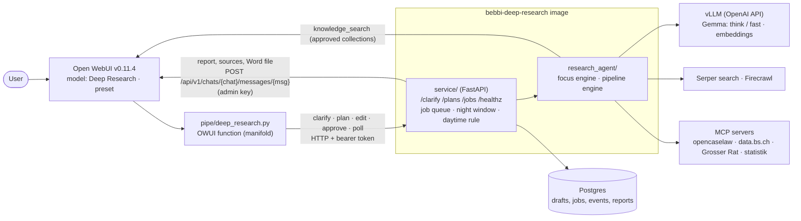

# bebbi-deep-research

Deep-research agent for **Bebbi Bot** (Open WebUI of the canton of Basel-Stadt). The user picks a model such as
"Deep Research · Recht" in the chat, answers at most two clarifying questions, approves or edits a research plan, and
gets a cited German report back in the same chat. Heavy runs happen at night; quick runs of the focus engine may start
during office hours.

This repository is the self-contained production deliverable. The evaluation that led to it (benchmarks, alternatives,
tuning history) lives in the evaluation repository, see [docs/evaluation.md](docs/evaluation.md).

## Architecture



* **pipe** (`pipe/deep_research.py`): Open WebUI manifold function, one model per preset. Depends only on `httpx` and
  `pydantic`. Keeps the conversation state in a hidden marker of the assistant message, emits the sources as native
  citations (`[n]` badges, source list) and attaches the Word file. `pipe/deep_research_download.py` is the action that
  adds the Word file to a report delivered later.
* **service** (`service/`): FastAPI job service. Chat-turn endpoints, a job queue in Postgres (SQLite for development),
  the night window, report delivery into the chat, structured sources and the Word export (`GET /jobs/{id}/report.docx`). Stateless apart from the database, so restarts re-queue running jobs.
* **engine** (`research_agent/`): the evaluated version (v6). Focus engine (tool-calling loop with code-resolved citations)
  for administrative presets, pipeline engine (plan, research rounds, section-wise writing) for broad web surveys.
* **config** (`config/presets.yaml`): presets, MCP servers, budgets. Mounted as ConfigMap in Kubernetes.

## Own sources (files and knowledge bases)

Files uploaded in the chat and knowledge bases attached to the chat or to the model are research sources next to the web (requirement A4).
The pipe checks inside Open WebUI, as the chat user, what the user may read (Open WebUI's own access functions) and sends the extracted file
texts and the knowledge base ids with the plan and the job; the service stores them with the job (night runs do not need the user's session),
the engine reads uploads with `read_upload` (small ones directly) and searches the knowledge bases with `knowledge_search` through Open WebUI's
retrieval endpoint, one approved id at a time. Citations show the file name ("Hochgeladene Datei") or document and knowledge base
("Wissensbasis ..."), with a link the user can open when Open WebUI allows it. Preset field `own_sources: prefer | only | off`; the model
"Deep Research · Eigene Dokumente" works on the user's documents alone. Limits: 10 files, 2,000,000 characters per file, 5 knowledge bases per
research (`RA_OWN_MAX_*`); text only (no OCR unless Open WebUI does it). Details, access rules and what was verified:
[docs/integration.md](docs/integration.md#5b-own-sources-uploaded-files-and-knowledge-bases-requirement-a4) and section 7 there.

## Quickstart (local)

```bash
uv sync                                  # Python 3.12+, uv
uv run pytest && uv run ruff check .

cp .env.example .env                     # fill in LLM, search, Firecrawl endpoints and secrets
docker compose up -d --build             # service + Postgres + Open WebUI v0.11.4
curl localhost:8088/readyz               # {"status":"ok","problems":[]}
uv run python scripts/install_pipe.py --models    # installs the pipe and sets the valves (docs/integration.md)
```

Open <http://localhost:3000>, pick "Deep Research · Grosser Rat" and ask a question. Without Open WebUI:

```bash
RA_TOKEN=... uv run python scripts/test_pipe.py "Welche Vorstösse zum Stadtklima gab es? Bitte schnell." grossrat
scripts/smoke_local.sh                   # starts the service on SQLite against the local evaluation stack
```

## Layout

| Path | Content |
|---|---|
| `research_agent/` | engine (copied from the evaluation, v5; `llm.py` got the per-role extra body, `own.py` and small hooks in `agent.py`/`focus.py` add the user's own sources) |
| `service/` | job service: settings, DB layer, job runner, FastAPI app, JSON logging |
| `pipe/` | Open WebUI functions: pipe and Word download action |
| `config/presets.yaml` | presets, MCP servers, budgets |
| `Dockerfile`, `compose.yaml` | image (multi-stage, uv, uid 10001, read-only root) and local stack |
| `deploy/helm/bebbi-deep-research/` | Helm chart |
| `deploy/openwebui/` | `function.json` and `models.json` for the seeder |
| `docs/` | integration, operations, presets, evaluation, MCP servers |
| `tests/`, `scripts/` | unit and service tests; pipe simulator, installer, smoke test, `e2e_owui.py` (drives a local Open WebUI like the browser) |

## Documentation

* [docs/integration.md](docs/integration.md): installing the pipe, valves, admin service account, seeder, fallback, native citations and Word download (section 5a), own sources (5b), upgrade checklist (9)
* [docs/operations.md](docs/operations.md): all environment variables, night window, scaling, logs, troubleshooting
* [docs/presets.md](docs/presets.md): presets, engines, budgets, adding presets and MCP servers
* [docs/evaluation.md](docs/evaluation.md): results and decisions of the evaluation
* [docs/mcp-servers.md](docs/mcp-servers.md): state and needs of the MCP servers
